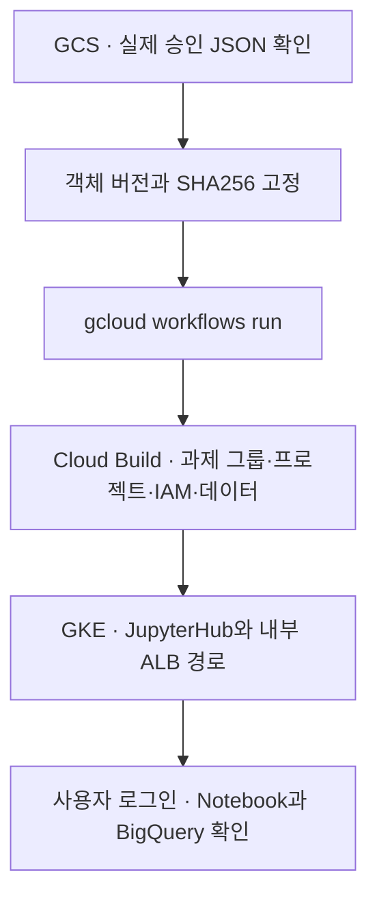

# 2차 Sandbox 배포 · sbx03

[1차 공통 인프라](01-infra-setup.md)가 준비됐으면, 관리 VM에서 **승인 요청 확인 → Workflow 제출 → 결과 검증** 순서로 실행합니다.



## 1. 승인 요청 읽기

포털이 GCS에 저장한 **승인된 요청 ID**를 입력합니다. 신규 프로젝트 사전 권한과 승인 JSON이 아직 준비되지 않았다면 [sbx03 신규 과제 절차 1~3절](sbx03-new-project-runbook.md)을 먼저 따릅니다. 같은 `sbx03`을 재배포할 때는 포털에서 새 요청 ID를 발급받습니다.

아래 블록을 같은 Bash 셸에서 실행합니다. 성공하면 검증된 입력 파일을 만듭니다. 다운로드나 검증이 실패하면 파일을 새로 만들지 않습니다.

```bash
read -r -p '승인된 sbx03 요청 ID: ' REQUEST_ID
REQUEST_URI="gs://gcp-sbx-edp-gke01-sbxtest01-requests/approved/${REQUEST_ID}/request.json"
mkdir -p .local &&
  rm -f .local/sbx03-workflow-input.json &&
  REQUEST_GENERATION="$(gcloud storage objects describe "$REQUEST_URI" --account=son@sonmap.net --format='value(generation)')" &&
  gcloud storage cp "${REQUEST_URI}#${REQUEST_GENERATION}" .local/sbx03-request.json --account=son@sonmap.net &&
  jq -e --arg id "$REQUEST_ID" '
    .request_id == $id and .approval.status == "APPROVED"
    and .task.name == "sbx03"
    and .project.project_id == "gcp-sbx-edp-sbx03"
    and .gke.project_id == "gcp-sbx-edp-gke01"
  ' .local/sbx03-request.json &&
  REQUEST_SHA256="$(sha256sum .local/sbx03-request.json | cut -d ' ' -f1)" &&
  jq -n --arg id "$REQUEST_ID" --arg uri "$REQUEST_URI" --arg gen "$REQUEST_GENERATION" --arg sha "$REQUEST_SHA256" \
    '{request_id:$id,approved_json_uri:$uri,generation:($gen|tonumber),sha256:$sha}' \
    > .local/sbx03-workflow-input.json
```

## 2. Workflow 제출

1절에서 `true`와 입력 파일 생성을 확인한 뒤 실행합니다.

```bash
test -s .local/sbx03-workflow-input.json &&
  gcloud workflows run workflow-sbxtest01-provision \
    --project=gcp-sbx-edp-gke01 --location=asia-northeast3 \
    --account=son@sonmap.net --data="$(cat .local/sbx03-workflow-input.json)"
```

Workflow의 `SUCCEEDED`와 응답의 `ACCEPTED`는 **배포 접수**입니다. 과제 배포 완료는 다음 단계의 빌드 결과에서 확인합니다.

## 3. 배포와 사용자 접속 확인

```bash
gcloud builds list --project=gcp-sbx-edp-gke01 --region=asia-northeast3 --account=son@sonmap.net --limit=10 --format='table(id,status,createTime)'

CLOUDSDK_CORE_ACCOUNT=son@sonmap.net kubectl --kubeconfig="$HOME/.kube/config-sbx-dns" -n sbx03 get pods,pvc

gcloud compute backend-services get-health bes-jupyter-sbx03 --project=gcp-sbx-edp-gke01 --region=asia-northeast3 --account=son@sonmap.net
```

이번 요청의 상위·하위 빌드가 `SUCCESS`이고 ALB 백엔드가 `HEALTHY`면 [JupyterHub](https://jupyter-sbx03.sonmap.net/hub/home)에서 Google 로그인과 Notebook 서버 시작을 시험합니다. Notebook에서 `echo "$HOME"`이 `/home/user01`을 표시하는지, 승인된 BigQuery 데이터셋을 조회할 수 있는지 확인합니다.

| 막힌 지점 | 열어야 할 문서 |
|---|---|
| Workflow 이후 빌드 실패 또는 대기 | [sbx03 실제 시험 기록](sbx03-new-project-runbook.md#6-실제-작업-기록과-다음-테스트-순서) |
| 이름 해석·443·인증서 오류 | [내부 HTTPS와 인증서](sbx03-https-certificate-runbook.md) |
| `redirect_uri_mismatch` 또는 로그인 거부 | [Google OAuth 로그인](sbx03-google-oauth-runbook.md) |
| 이전 Notebook 이미지 또는 홈 경로 | [Notebook 이미지와 Helm 적용](../04.Jupiter-setup-image/README.md) |
