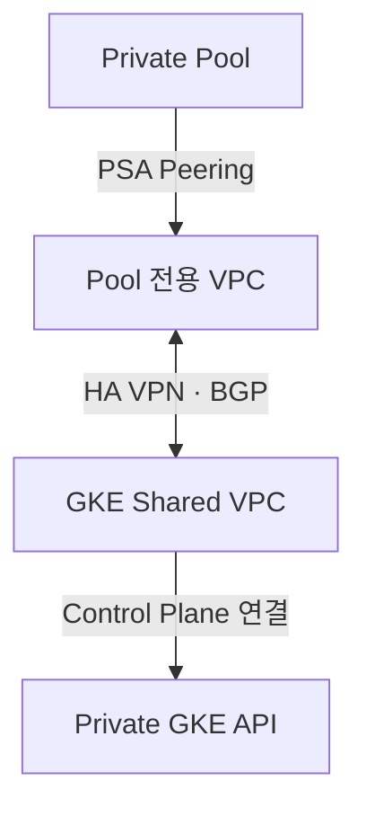

# Private Pool → GKE 사설 접속 실제 점검

[실제 수행 절차](runbook-two-stage.md)의 5단계에서 사용합니다. 현재 `02.sandbox_setup_01_gcloud/configs/provisioner-env.yaml`은 GKE_ENDPOINT_MODE=internal입니다. 이 문서와 YAML은 **접속 점검**이며 VPN/BGP를 자동 구축하지 않습니다.

## 1. 먼저 실제 Pool에서 검사

공통 기반 bootstrap 이미지가 빌드된 뒤 저장소 루트에서 실행합니다. 이 블록에 필요한 변수를 모두 포함했습니다.

```bash
export SBX_GKE_PROJECT="pjt-d-host01"
export ADMIN_ACCOUNT="admin@sonmap.net"
export l2comn_PROJECT="prj-b-cicd-local-236d"
export REGION="asia-northeast3"
export TF_MANAGER="tf-manager@${SBX_GKE_PROJECT}.iam.gserviceaccount.com"
export TF_MANAGER_RESOURCE="projects/${SBX_GKE_PROJECT}/serviceAccounts/${TF_MANAGER}"

gcloud builds submit --no-source --config=01.docs/check-private-gke.yaml --project="${l2comn_PROJECT}" --region="${REGION}" --service-account="${TF_MANAGER_RESOURCE}" --account="${ADMIN_ACCOUNT}" --impersonate-service-account="${TF_MANAGER}"
```

`check-private-gke.yaml`은 Private Pool에서 `get-credentials --internal-ip` 후 `kubectl get namespaces`만 실행합니다. 성공 기준은 Build SUCCESS와 Namespace 목록입니다. 사용자 환경을 설치하거나 네트워크를 변경하지 않습니다.

## 2. 실패 원인을 구분

| 실패 지점/로그 | 실제 확인 사항 |
|---|---|
| bootstrap 이미지 Pull 실패 | 기반 Build 성공 여부·AR 이미지·Build 계정 권한 |
| container.clusters.get 403 | tf-manager의 GKE 프로젝트 권한 |
| get-credentials 성공 후 kubectl timeout | Private IP 라우팅·VPN/BGP·방화벽·Authorized Networks |
| kubectl Unauthorized/Forbidden | Build 인증·GKE IAM/Kubernetes 접근 권한 |
| Google API/DNS 연결 실패 | Private Pool의 API/DNS 접근 경로 |

관리 VM에서 kubectl이 된다는 사실만으로 Pool의 경로가 된다고 판단하지 않습니다. VM과 Pool은 소스 대역/라우팅 경로가 다릅니다.

## 3. 라우팅이 준비되지 않았다면 네트워크 담당 작업

Cloud Build Pool와 GKE Control Plane은 Google 관리 네트워크에서 VPC에 연결됩니다. PSA/VPC Peering은 전이 라우팅을 제공하지 않으므로 같은 Shared VPC에 연결하는 기본 명령만으로 상호 Private IP 경로가 완성되지는 않습니다.

네트워크 담당자는 승인된 토폴로지에서 Pool CIDR과 GKE Control Plane CIDR의 양방향 경로·BGP 광고·커스텀 경로 전파, Authorized Networks, 방화벽을 준비합니다. Pool 전용 VPC+HA VPN을 선택하면 다음 관계를 실제 구성한 뒤 1번 점검을 다시 실행합니다.



현재 03-foundation의 Pool은 기존 Shared VPC를 대상으로 생성합니다. 다른 Pool VPC 설계를 적용할 때는 Pool peered-network/PSA 대상도 함께 맞춰야 합니다. 기존 Pool의 연결 대상을 문서 읽기만으로 자동 전환하지 않습니다. 전용 VPC/VPN/BGP 생성 명령은 이 저장소의 기본 구축 범위에 포함되어 있지 않습니다.

## 4. 승인된 DNS endpoint 대안

사설 IP 경로 대신 DNS endpoint를 쓰기로 별도 결정한 경우에만 다음 작업을 수행합니다.

1. GKE 담당자가 해당 Cluster의 DNS endpoint/token 접근 설정과 IAM/API/DNS 경로를 검토·준비합니다.
2. provisioner-env.yaml의 GKE_ENDPOINT_MODE를 dns로 바꾸고, 운영자가 해당 환경 파일을 Run에 반영합니다. 이때 기존 다른 환경변수도 파일 내용으로 함께 설정되므로 먼저 확인합니다.
3. DNS 전용 점검용 YAML에서 get-credentials 옵션을 --dns-endpoint로 바꾸어 실제 Pool Build를 검사합니다. 기본 check-private-gke.yaml은 사설 IP 검사이므로 그대로 성공 기준으로 쓰지 않습니다.

최종 선택한 접속 방식이 실제 Pool에서 통과한 후에만 과제 요청을 제출합니다. 기본 사설 IP 설정을 DNS로 자동 완화하지 않습니다.
