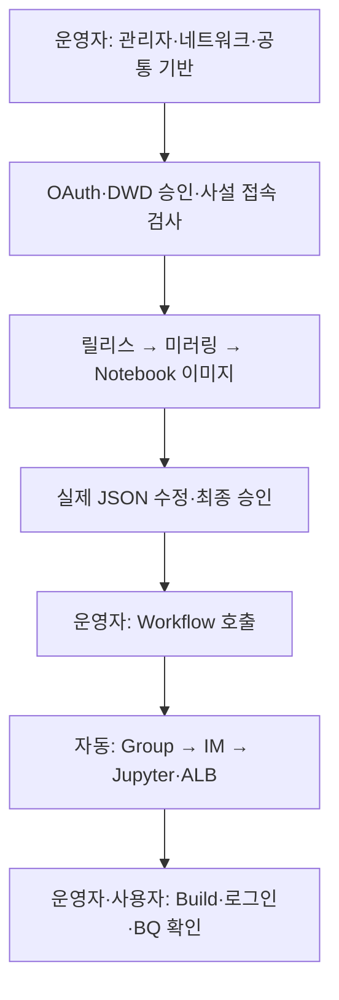
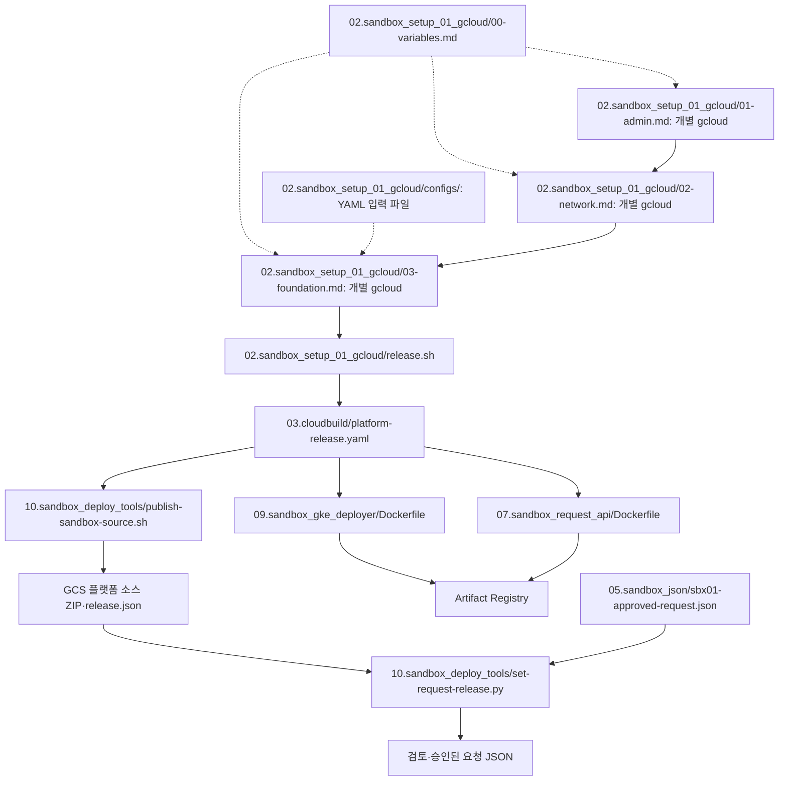
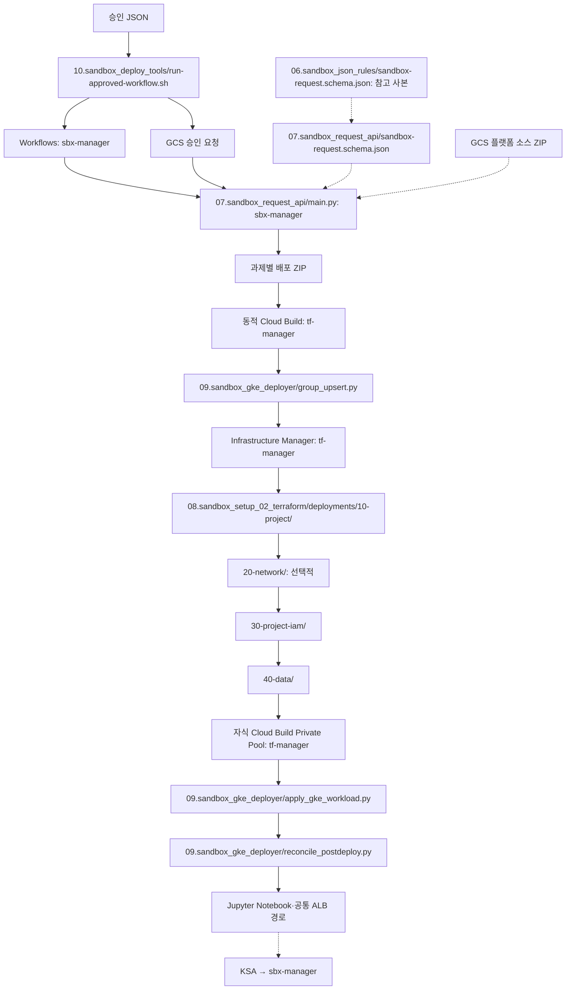
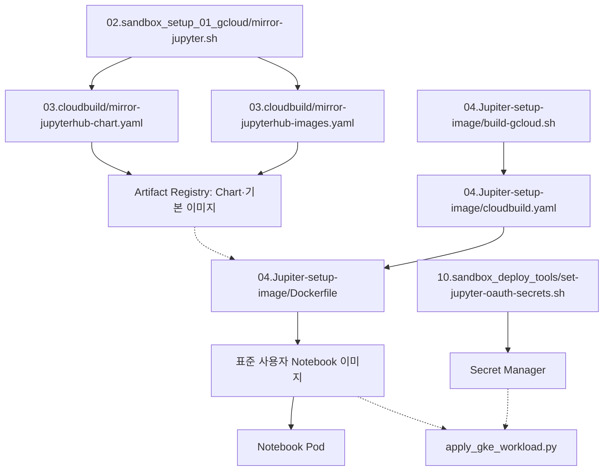

# 폴더와 파일 관계

실제 수동 수행은 [실행 절차](runbook-two-stage.md)를 따릅니다. 아래 그림의 API/IM/GKE 단계는 승인 요청 제출 후 자동 호출됩니다.

실선은 실행/호출, 점선은 설정/소스 참조입니다. 1~3단계는 모두 gcloud입니다.

각 Terraform 폴더의 main.tf/variables.tf/versions.tf는 함께 읽습니다. 최초 기반용 Terraform 00-admin/00-network-host/01-foundation과 중복 배포 경로는 제거했습니다. 10.sandbox_deploy_tools/group_upsert.py는 Runner 안의 동일 파일과 동기화해 유지합니다.
