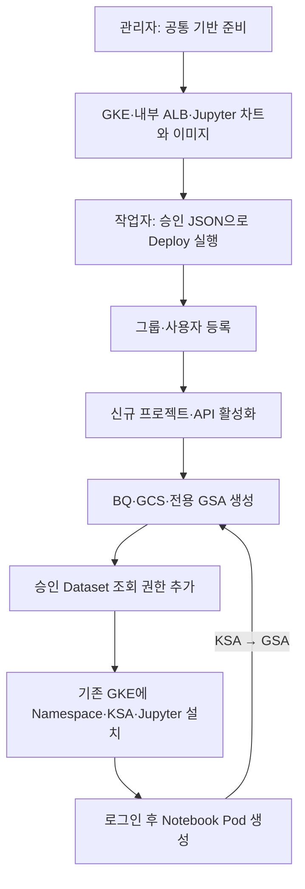

# sbx03 신규 프로젝트 자동 생성

이 문서는 기존 `pjt-net-hub-base` 재사용 절차 대신 사용하는 신규 과제 절차입니다.
GCP 자원은 이 문서 수정만으로 생성되지 않습니다. API 이미지·runner 이미지·Terraform ZIP을 모두 같은 새 release로 발행한 뒤 Deploy합니다.

## 확정 구성

| 구분 | 값 |
|---|---|
| 플랫폼 / 기존 GKE | gcp-sbx-edp-gke01 / gke-sbx-main-an3 |
| 신규 과제 프로젝트 ID 예정 | gcp-sbx-edp-sbx03 (전역 ID 사용 가능 여부는 생성 시 확인) |
| 상위 조직 | 51654893849 (Folder 지정 안 함) |
| 결제 계정 | 019BE7-53DD39-AF5098 |
| Workspace 고객 | C03rw3vtp |
| 그룹 / 사용자 | pgrp-gcp-dev-sbx03@sonmap.net / user01, user02 |
| 신규 BQ / GCS | sbx03_main / gcp-sbx-edp-sbx03-sbx03-data |
| 위치 | asia-northeast3 |
| 신규 GSA | gsa-jupyter-sbx03@gcp-sbx-edp-sbx03.iam.gserviceaccount.com |
| 기존 GKE의 Namespace / KSA | sbx03 / ksa-jupyter-sbx03 |
| 데이터레이크 조회 범위 | pjt-c-admin.dlk_sample 전체 Dataset (TABLE 2개, View 아님) |
| 접속 도메인 예정 | jupyter-sbx03.sonmap.net |

`tf-manager`는 배포 실행, `sbx-manager`는 Run/Workflows 실행 계정으로 유지합니다.
과제의 Notebook은 새 프로젝트의 전용 GSA를 사용합니다. GSA 키를 생성하지 않습니다.



## 1. 최초 관리자 준비 (수동)

수행: `admin@sonmap.net`. 프로젝트 Creator는 조직에, Billing User는 결제 계정에 설정합니다.
이미 적용한 바인딩은 추가할 필요 없습니다. 프로젝트 Owner와 Billing Admin은 별도입니다.

```bash
gcloud organizations add-iam-policy-binding 51654893849 --member="serviceAccount:tf-manager@gcp-sbx-edp-gke01.iam.gserviceaccount.com" --role=roles/resourcemanager.projectCreator --account=admin@sonmap.net
```

결제 계정 CLI IAM 조회/변경이 INVALID_ARGUMENT인 환경에서는 직접 API로 **최신 전체 정책과 etag를 보존**하여 멤버를 추가합니다. 아래 각 명령이 성공한 경우에만 다음 명령을 실행합니다.

```bash
curl --fail-with-body --silent --show-error --max-time 30 -H "Authorization: Bearer $(gcloud auth print-access-token --account=admin@sonmap.net)" "https://cloudbilling.googleapis.com/v1/billingAccounts/019BE7-53DD39-AF5098:getIamPolicy?options.requestedPolicyVersion=3" -o /tmp/sbx-billing-policy.json
```

```bash
jq -e 'select(.etag and .bindings) | if any(.bindings[]; .role == "roles/billing.user") then .bindings |= map(if .role == "roles/billing.user" then .members = ((.members + ["serviceAccount:tf-manager@gcp-sbx-edp-gke01.iam.gserviceaccount.com"]) | unique) else . end) else .bindings += [{"role":"roles/billing.user","members":["serviceAccount:tf-manager@gcp-sbx-edp-gke01.iam.gserviceaccount.com"]}] end | {policy: .}' /tmp/sbx-billing-policy.json > /tmp/sbx-billing-policy-update.json
```

```bash
curl --fail-with-body --silent --show-error --max-time 30 -X POST -H "Authorization: Bearer $(gcloud auth print-access-token --account=admin@sonmap.net)" -H "Content-Type: application/json" --data-binary @/tmp/sbx-billing-policy-update.json "https://cloudbilling.googleapis.com/v1/billingAccounts/019BE7-53DD39-AF5098:setIamPolicy"
```

Workspace Groups Administrator를 tf-manager 고유 ID `110363249940059352517`에 직접 부여하는 작업은 완료된 상태입니다. Workspace roleId는 `51443659324784642`입니다. DWD·SA 키는 필요하지 않습니다.

### 데이터레이크 관리자 사전 위임

Terraform이 **새로 만들어질 GSA**에 Dataset 조회 권한을 자동 추가하려면 tf-manager가 대상 Dataset IAM을 변경할 권한이 필요합니다. 플랫폼 프로젝트 권한만으로는 불가능합니다.
기존 `sa-im-data-admin`의 권한을 자동으로 상속받는 구조도 아닙니다.

최초 수동 작업: `pjt-c-admin`의 BQ 관리자가 승인 Dataset에만 tf-manager의 IAM 관리 권한을 위임합니다. 기본 역할을 사용할 때 `roles/bigquery.dataOwner`는 IAM 외 데이터 변경 권한도 포함하므로 그 범위를 확인해야 합니다. 프로젝트 전체 Owner 부여는 필요하지 않습니다.
위임 전에는 datalake_datasets를 포함한 Deploy를 실행하지 않습니다.

Notebook GSA에는 Terraform이 `roles/bigquery.dataViewer`만 추가합니다. `roles/bigquery.jobUser`는 새 과제 프로젝트에 부여하여 쿼리 비용이 과제 프로젝트에 청구되도록 합니다. 특정 View만 허용할 경우 이 Dataset 전체 조회 설정을 사용하지 말고 View 권한 설계를 별도로 해야 합니다.

## 2. 코드 동기화와 새 릴리스 (수동)

기존 로컬 변경을 먼저 확인하고 필요한 설정 파일을 백업합니다. 로컬 수정이 남아 있으면 덮어쓰지 말고 병합합니다.

```bash
git status --short
```

```bash
git pull --ff-only
```

Customer ID는 더 이상 예시 문자열을 넣지 않고 확인된 실제 값을 사용합니다. DNS 모드는 현재 성공한 연결 방식입니다. DNS 모드 성공만으로 통신회사 사설망 경로 준수까지 입증되는 것은 아닙니다.

```bash
sed -i 's/^CLOUD_IDENTITY_CUSTOMER_ID:.*/CLOUD_IDENTITY_CUSTOMER_ID: C03rw3vtp/' 02.sandbox_setup_01_gcloud/configs/provisioner-env.yaml
```

새 릴리스 이름은 이번 코드 전용 `sbx03-20261107-v1`입니다. 이 태그가 이미 있다면 덮어쓰지 말고 v2 등 새 이름을 사용합니다.
다음 Cloud Build는 공통 배포 도구/API 이미지·Terraform ZIP을 발행하고 Run API를 갱신하며, **과제 프로젝트 생성 자체는 실행하지 않습니다**. 빌드 실행 SA의 Run 배포·이미지/GCS 권한은 공통 준비 사항입니다.

```bash
gcloud builds submit . --config=03.cloudbuild/platform-release.yaml --project=gcp-sbx-edp-gke01 --region=asia-northeast3 --account=son@sonmap.net --service-account=projects/gcp-sbx-edp-gke01/serviceAccounts/tf-manager@gcp-sbx-edp-gke01.iam.gserviceaccount.com --gcs-source-staging-dir=gs://gcp-sbx-edp-gke01-sbxtest01-build-source/source --substitutions="_RELEASE_ID=sbx03-20261107-v1,_COMMIT_SHA=$(git rev-parse HEAD)"
```

## 3. 요청 준비 (포탈 JSON)

[신규 과제 요청 템플릿](../05.sandbox_json/sbx03-request.template.json)을 사용합니다. `approval.status=PENDING`, 승인 번호/일시 공란, source 해시 0인 **배포 불가 초안**입니다. 포탈의 실제 승인 정보와 새 릴리스 결과를 넣어야 합니다. 예전 승인 정보나 manual-20261107의 ZIP/해시를 재사용하지 않습니다.

```bash
gcloud storage cat gs://gcp-sbx-edp-gke01-sbxtest01-bundles/platform-releases/sbx03-20261107-v1/release.json --account=son@sonmap.net
```

릴리스 확인 후 `source`에 해당 archive_uri/generation/sha256/release_id를 그대로 반영합니다.
과제 프로젝트와 GSA·그룹·BQ·GCS는 수동 생성하지 않습니다. 승인 JSON 업로드 및 Workflows Deploy는 [기존 명령 절차](operator-command-guide.md)를 따릅니다.

## 4. 자동 수행 영역

1. Workspace 그룹과 구성원 생성.
2. 신규 프로젝트 생성·Billing 연결·API 활성화·배포 SA 권한 설정.
3. 그룹의 과제 프로젝트 권한 설정.
4. 새 프로젝트 전용 GSA·BQ·GCS 생성 및 권한 부여.
5. 승인 데이터레이크 Dataset에 전용 GSA의 dataViewer 추가.
6. GKE 프로젝트의 `gcp-sbx-edp-gke01.svc.id.goog[sbx03/ksa-jupyter-sbx03]`를 새 GSA의 workloadIdentityUser로 연결.
7. KSA annotation, JupyterHub 설정, NEG·과제별 ALB 백엔드와 URL Map 경로 구성 및 검증.
8. 로그인한 사용자의 Notebook Pod 생성.

기존 요청은 `identity.create_jupyter_gsa`를 생략하면 기존 공통 SA를 사용합니다. 신규 프로젝트 요청은 이 값을 true로 지정해야 합니다. 전용 GSA 이름 제한 때문에 task.name은 최대 18자입니다.

## 5. 아직 남은 수동 작업

- 내부 ALB VIP 172.31.96.2와 공통 헬스 체크·백엔드·URL Map은 준비됨.
- 인증서·HTTPS 프록시·전달 규칙·DNS 연결은 별도 진행. 이것이 완료되어야 사용자 HTTPS 접속 가능.
- OAuth 실제 값·redirect URI에 신규 도메인 반영 확인.
- 데이터레이크 Dataset IAM 위임 및 신규 프로젝트의 조직 정책·할당량 확인.
- GCS 저장 자동 트리거는 후속 작업. 현재는 작업자가 Deploy만 시작하고 이후 과제 생성은 자동 실행.

로컬 테스트는 통과했지만 실제 새 프로젝트 생성, GSA 토큰 발급, BQ 쿼리는 클라우드 배포 후 검증해야 합니다.
