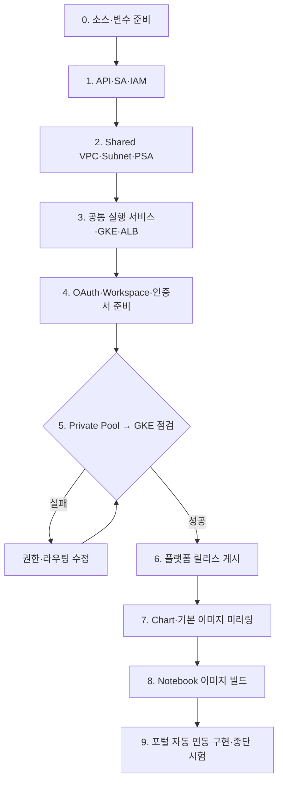
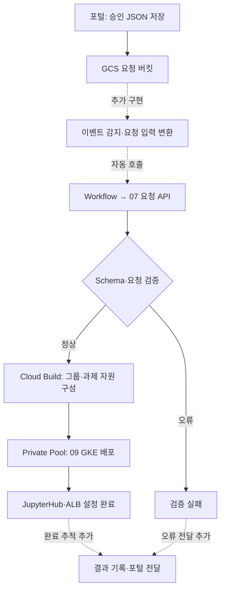

# 작업 순서와 실행 링크

주 대상은 **SBX_GKE_PROJECT="pjt-d-host01"**입니다. 아래 Mermaid 번호와 표의 번호를 맞춰 작업합니다. **표의 실행 문서 링크를 눌러 명령을 확인하고, 관리 VM의 저장소 루트 GCP_SBX_Test01에서 한 단계씩 실행합니다.** 폴더 링크는 소스 확인용이며 링크 클릭만으로 GCP 작업이 실행되지는 않습니다. 하위 폴더로 이동해서 명령을 실행하면 상대경로가 달라질 수 있습니다.

## ① 공통 기반 준비 — 관리자 수동·반자동

최초 구축하거나 공통 설정·이미지를 변경할 때 수행합니다. 과제마다 반복하지 않습니다. 기존 자원은 조회 후 필요한 명령만 실행합니다.

| 순서 | 작업자 / 작업 | 실행 문서 — 클릭 후 명령 실행 | 관련 폴더 | 완료 기준 |
|---|---|---|---|---|
| 0 | 운영자: 소스 받기·도구·변수 확인 | [소스 준비](runbook-two-stage.md#0-소스-받기기본-변수-설정), [공통 변수](../02.sandbox_setup_01_gcloud/00-variables.md) | [01.docs](../01.docs), [02.gcloud](../02.sandbox_setup_01_gcloud) | 계정·프로젝트 조회 성공 |
| 1 | 권한 관리자: API·sbx-manager·tf-manager·IAM | [01-admin.md](../02.sandbox_setup_01_gcloud/01-admin.md) | [02.gcloud](../02.sandbox_setup_01_gcloud) | 두 SA 조회·위임 성공 |
| 2 | 인프라 관리자: VPC·Subnet·PSA·방화벽 | [02-network.md](../02.sandbox_setup_01_gcloud/02-network.md) | [02.gcloud](../02.sandbox_setup_01_gcloud) | 대역·연결 확인 |
| 3 | 인프라 관리자: GCS·AR·Pool·GKE·Run·Workflow·ALB | [03-foundation.md](../02.sandbox_setup_01_gcloud/03-foundation.md) | [02.gcloud](../02.sandbox_setup_01_gcloud), [03.cloudbuild](../03.cloudbuild) | GKE RUNNING·API healthz 정상 |
| 4 | OAuth·Workspace·DNS·데이터 담당자: 인증·외부 BQ 권한 준비 | [OAuth 등록 명령](../02.sandbox_setup_01_gcloud/04-manual-gcloud.md#4-oauth-값-등록), [Workspace 위임](runbook-two-stage.md#4-2-workspace-domain-wide-delegation), [인증·도메인 안내](jupyterhub-external-alb-oauth-runbook.md) | [01.docs](../01.docs), [02.gcloud](../02.sandbox_setup_01_gcloud) | OAuth Secret ENABLED·DWD 승인·도메인/인증서 준비 |
| 5 | 운영자: Private Pool에서 GKE API 조회 | [접속 점검 명령](runbook-two-stage.md#5-private-pool에서-gke-사설-api-연결-확인), [점검 YAML](check-private-gke.yaml) | [01.docs](../01.docs) | 점검 Build SUCCESS |
| 6 | 운영자: API·배포 도구 이미지와 Terraform 소스 게시 | [플랫폼 릴리스 명령](../02.sandbox_setup_01_gcloud/04-manual-gcloud.md#5-플랫폼-릴리스-게시) | [03.cloudbuild](../03.cloudbuild) | Build SUCCESS·release.json 생성 |
| 7 | 운영자: Chart·기본 이미지를 내부 AR로 복사 | [미러링 명령](../02.sandbox_setup_01_gcloud/04-manual-gcloud.md#6-chart와-기본-이미지-미러링) | [03.cloudbuild](../03.cloudbuild) | 두 Build SUCCESS |
| 8 | 운영자: Notebook 표준 이미지 빌드 | [Notebook 빌드 명령](../02.sandbox_setup_01_gcloud/04-manual-gcloud.md#7-notebook-표준-이미지-빌드) | [04.Notebook 이미지](../04.Jupiter-setup-image) | 이미지 조회 성공 |
| 9 | 개발자·운영자: GCS 이벤트 연결·결과 전달 구현 후 전체 시험 | [자동화 범위와 미구현 항목](#운영-과제-자동화), [시험·검증 절차](runbook-two-stage.md) | [07.API](../07.sandbox_request_api), [10.점검 도구](../10.sandbox_deploy_tools), [11.테스트](../11.tests) | GCS 저장만으로 배포 시작·최종 결과 확인 |

3단계의 HTTPS Proxy 구성 전에 인증서가 필요합니다. 인증서가 없다면 해당 명령을 보류하고 4단계 담당자 준비 후 완료합니다. Private Pool의 GKE 사설 경로는 PSA 생성만으로 완성되지 않으며, 5단계 통과가 필수입니다.

## 운영 과제 자동화

포털이 승인 JSON을 GCS에 저장한 뒤에는 작업자가 명령을 실행하지 않는 것이 운영 기준입니다. **현재 GCS 이벤트 시작·이벤트 입력 변환·Build 최종 결과의 포털 전달은 추가 구현 대상**입니다. 아래 점선은 그 미구현 연결을 표시합니다. 현재 Workflow의 성공은 접수 성공이며 배포 완료를 의미하지 않습니다.

| 처리 순서 | 자동 처리 내용 | 코드·폴더 링크 | 운영자 수동 실행 |
|---|---|---|---|
| A | 포털이 승인 요청·고정 릴리스 정보를 JSON으로 저장 | [05.포털 요청 샘플](../05.sandbox_json) | 없음 |
| B | GCS 이벤트 감지·URI/generation/SHA256 등 입력 구성 | 추가 구현 대상 | 구현 후 없음 |
| C | Workflow 호출 → API의 Schema·의미 검증 | [Workflow 설정](../02.sandbox_setup_01_gcloud/configs/workflow.template.yaml), [06.검증 규칙](../06.sandbox_json_rules), [07.요청 API](../07.sandbox_request_api) | 없음 |
| D | 그룹 동기화 → Project → 선택 Network → IAM → Data | [08.과제 Terraform](../08.sandbox_setup_02_terraform), [09.그룹·GKE 배포 코드](../09.sandbox_gke_deployer) | 없음 |
| E | Namespace·KSA·JupyterHub·과제 ALB 연결 | [09.GKE 배포](../09.sandbox_gke_deployer) | 없음 |
| F | Build 최종 상태 확인·포털 결과 전달 | 추가 구현 대상 | 구현 후 없음 |

공통 GKE는 SBX_GKE_PROJECT, 공통 VPC는 VPC_HOST_PROJECT, 자동화 실행은 l2comn_PROJECT, 과제 데이터·Query Job은 SBX_PROJECT를 사용합니다. 과제 처리 중 08/09 폴더에서 terraform apply나 Python 파일을 직접 실행하지 않습니다. 사용자의 Notebook Pod는 배포 직후가 아니라 로그인 후 서버를 시작할 때 생성됩니다.

## 수동 연동 시험·장애 점검

포털 연동 전에는 [실제 수행 절차의 9~11단계](runbook-two-stage.md)를 사용해 요청을 제출하고 배포·로그인·BQ를 확인합니다. [10.sandbox_deploy_tools](../10.sandbox_deploy_tools)는 시험·점검 도구이며 운영 요청마다 사람이 실행하는 필수 단계가 아닙니다. [11.tests](../11.tests)는 코드 변경 후 검사에 사용합니다.
