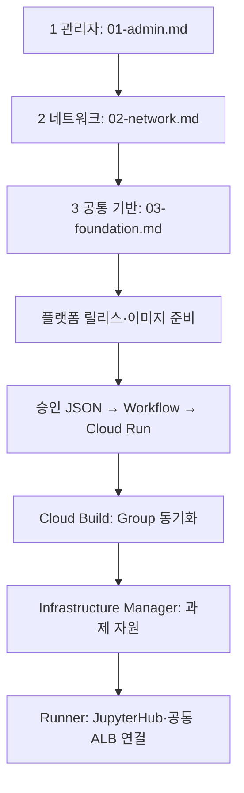

# GCP_SBX_Test01

승인 JSON으로 GKE Jupyter Sandbox를 만드는 테스트 저장소입니다. **최초 구축 1~3단계는 Terraform 대신 gcloud**, 사용자 관리 서비스 계정은 **두 개**를 사용합니다.

## 폴더 번호와 작업 우선순위

| 순서 | 폴더 | 주 작업 |
|---|---|---|
| 01 | `01.docs/` | 실행 설명서·구성도 먼저 확인 |
| 02 | `02.sandbox_setup_01_gcloud/` | 최초 인프라·권한 준비 |
| 03 | `03.cloudbuild/` | 실행 이미지 빌드·릴리스·미러링 준비 |
| 04 | `04.Jupiter-setup-image/` | 사용자 Notebook 이미지 준비 |
| 05 | `05.sandbox_json/` | 과제 신청 JSON 작성 |
| 06 | `06.sandbox_json_rules/` | 신청 JSON 필수 항목·허용값 검사 |
| 07 | `07.sandbox_request_api/` | Cloud Run에서 신청 접수·배포 시작 |
| 08 | `08.sandbox_setup_02_terraform/` | 과제 프로젝트·IAM·Dataset·GCS 구성 |
| 09 | `09.sandbox_gke_deployer/` | GKE·JupyterHub 설치·ALB 연결 |
| 10 | `10.sandbox_deploy_tools/` | 위 작업에서 공통으로 쓰는 보조 도구 |
| 11 | `11.tests/` | 변경 사항 검증 |

번호는 **문서 확인 → 기반 준비 → 신청 처리 → 과제 배포**의 주 작업 흐름입니다. Cloud Build는 필요한 API/배포 도구 이미지를 준비 단계에서 함께 빌드하고, 이후 API·Terraform·GKE 모듈을 자동으로 호출합니다. 보조 도구는 각 단계에서 재사용하며 테스트는 변경 후·배포 전에 실행합니다.

각 단계의 실제 명령 순서는 [실행 설명서](01.docs/runbook-two-stage.md)를 따릅니다. 아래 인프라 명령 문서는 코드 블록 맨 앞에 필요한 변수 선언을 포함합니다.

| 단계 | 작업 | 개별 명령어 |
|---|---|---|
| 준비 | 공통 변수 설정 | [00-variables.md](02.sandbox_setup_01_gcloud/00-variables.md) |
| 1 | 관리자 권한·서비스 계정 | [01-admin.md](02.sandbox_setup_01_gcloud/01-admin.md) |
| 2 | Shared VPC·서브넷·PSA·방화벽 | [02-network.md](02.sandbox_setup_01_gcloud/02-network.md) |
| 3 | Cloud Run·Cloud Build·GKE·Workflow·ALB | [03-foundation.md](02.sandbox_setup_01_gcloud/03-foundation.md) |
| 이후 과제별 | 프로젝트·IAM·BigQuery·GCS | Infrastructure Manager의 Terraform |

**1~3단계는 개별 gcloud 명령을 한 줄씩 복사하여 실행합니다.** Python 통합 실행기와 config.json은 제거했습니다. 전체 실행 스크립트·--apply 모드는 없습니다. 조회 결과를 확인하고 없는 자원만 생성합니다.

```bash
git clone https://github.com/sonmap/GCP_SBX_Test01.git
cd GCP_SBX_Test01
```

[공통 변수](02.sandbox_setup_01_gcloud/00-variables.md)를 같은 터미널에 설정한 후 1 → 2 → 3 순서로 진행합니다. 최신 Google Cloud CLI와 Bash가 필요합니다. 1~3단계 명령 실행에는 Python·Terraform 설치가 필요하지 않습니다. Cloud Build/Run/Workflows용 YAML은 [`02.sandbox_setup_01_gcloud/configs/`](02.sandbox_setup_01_gcloud/configs/)에 있습니다. 이후 과제별 자동화의 Python 프로그램은 유지합니다.

| 표시 이름 | 실제 서비스 계정 ID | 용도 |
|---|---|---|
| sbx_manager | sbx-manager | 요청 처리·Workflow·Notebook |
| tf_manager | tf-manager | 기반 구축·Build·Infrastructure Manager·GKE·ALB |

밑줄은 GCP 서비스 계정 ID에 사용할 수 없어 실제 ID는 하이픈으로 지정했습니다. Google 서비스 에이전트/노드 기본 SA와 Kubernetes KSA는 별도입니다.

**계정 통합으로 Notebook도 요청 처리 계정의 권한을 공유합니다. 과제별 데이터 격리와 제어 계정 격리가 없는 신뢰 사용자 PoC용입니다.** [권한·전환 범위](01.docs/architecture-and-operations.md)를 확인하세요.



- [전체 파일 관계](01.docs/file-relationships.md)
- [파일별 설명](01.docs/file-catalog.md)
- [실행 절차](01.docs/runbook-two-stage.md)
- [권한·기존 환경 전환](01.docs/architecture-and-operations.md)
- [Private Pool ↔ GKE VPN 설계](01.docs/cloudbuild-private-gke-vpn-design.md)

원본: `sonmap/Gcp_Managed_GKE_GIT_ETC_09` @ `4f0cae91c6483380b4e2fb2b705a63129db395eb`.
원본 저장소는 수정하지 않았습니다. 이 저장소의 변경만으로 GCP 자원이 생성되지는 않습니다.
