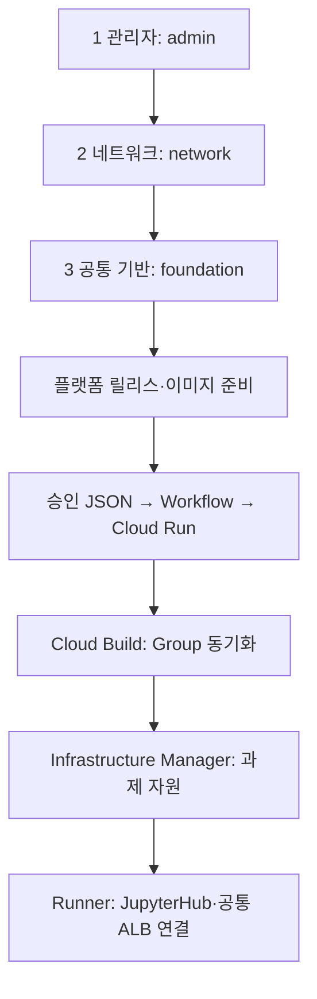

# GCP_SBX_Test01

승인 JSON으로 GKE Jupyter Sandbox를 만드는 테스트 저장소입니다. **최초 구축 1~3단계는 Terraform 대신 gcloud**, 사용자 관리 서비스 계정은 **두 개**를 사용합니다.

| 단계 | 작업 | 실행 |
|---|---|---|
| 1 | 관리자 권한·서비스 계정 | `python3 gcloud/bootstrap.py admin` |
| 2 | Shared VPC·서브넷·PSA·방화벽 | `python3 gcloud/bootstrap.py network` |
| 3 | Cloud Run·Cloud Build·GKE·Workflow·ALB | `python3 gcloud/bootstrap.py foundation` |
| 이후 과제별 | 프로젝트·IAM·BigQuery·GCS | Infrastructure Manager의 Terraform |

명령은 기본적으로 **출력만** 합니다. `--apply`를 붙이면 GCP에 적용합니다.

```bash
git clone https://github.com/sonmap/GCP_SBX_Test01.git
cd GCP_SBX_Test01
cp gcloud/config.example.json gcloud/config.json
python3 gcloud/bootstrap.py admin
```

설정과 출력 명령을 검토한 뒤 단계별 실행은 [실행 절차](docs/runbook-two-stage.md)를 따릅니다. 로컬 Python은 3.10 이상, 실행 VM에는 최신 Google Cloud CLI가 필요합니다. 1~3단계에는 Terraform이 필요하지 않습니다.

| 표시 이름 | 실제 서비스 계정 ID | 용도 |
|---|---|---|
| sbx_manager | sbx-manager | 요청 처리·Workflow·Notebook·데이터레이크 |
| tf_manager | tf-manager | 기반 구축·Build·Infrastructure Manager·GKE·ALB |

밑줄은 GCP 서비스 계정 ID에 사용할 수 없어 실제 ID는 하이픈으로 지정했습니다. Google 서비스 에이전트/노드 기본 SA와 Kubernetes KSA는 별도입니다.

**계정 통합으로 Notebook도 요청 처리 계정의 권한을 공유합니다. 과제별 데이터 격리와 제어 계정 격리가 없는 신뢰 사용자 PoC용입니다.** [권한·전환 범위](docs/architecture-and-operations.md)를 확인하세요.



- [전체 파일 관계](docs/file-relationships.md)
- [파일별 설명](docs/file-catalog.md)
- [실행 절차](docs/runbook-two-stage.md)
- [권한·기존 환경 전환](docs/architecture-and-operations.md)
- [Private Pool ↔ GKE VPN 설계](docs/cloudbuild-private-gke-vpn-design.md)
- [별도 데이터레이크 조회 권한 자동화](datalake-access-provisioner/README.md)

원본: `sonmap/Gcp_Managed_GKE_GIT_ETC_09` @ `4f0cae91c6483380b4e2fb2b705a63129db395eb`.
원본 저장소는 수정하지 않았습니다. 이 저장소의 변경만으로 GCP 자원이 생성되지는 않습니다.
