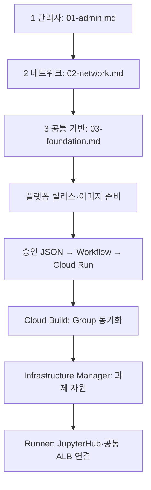

# GCP_SBX_Test01

승인 JSON으로 GKE Jupyter Sandbox를 만드는 테스트 저장소입니다. **최초 구축 1~3단계는 Terraform 대신 gcloud**, 사용자 관리 서비스 계정은 **두 개**를 사용합니다.

## 폴더별 역할

| 폴더 | 역할 |
|---|---|
| `infra_setup_gcloud/` | 최초 1·2·3단계 인프라 구성 명령 |
| `sandbox_json/` | 과제 신청 JSON |
| `sandbox_json_rules/` | 신청 JSON의 필수 항목·허용값 검사 규칙 |
| `sandbox_request_api/` | Cloud Run에서 신청 접수·검증·배포 시작 |
| `sandbxo_setup_terraform/` | 과제별 프로젝트·IAM·Dataset·GCS 구성 |
| `sandbox_gke_deployer/` | Cloud Build에서 GKE·JupyterHub·ALB 연결 |
| `Jupiter-setup-image/` | 사용자가 접속할 Notebook 이미지 제작 |
| `sandbox_deploy_tools/` | JSON 업로드·소스 ZIP 게시·Secret 등록 등 보조 도구 |
| `cloudbuild/` | 이미지 빌드·미러링·릴리스 작업 순서 |
| `docs/` | 실행 설명서·구성도 |

`sandbox_json_rules`는 신청서의 **작성 규칙**, `sandbox_json`은 실제 **신청 내용**입니다. `sandbox_deploy_tools`는 기존 scripts를 배포 보조 도구라는 뜻으로 바꾼 이름입니다.

| 단계 | 작업 | 개별 명령어 |
|---|---|---|
| 준비 | 공통 변수 설정 | [00-variables.md](infra_setup_gcloud/00-variables.md) |
| 1 | 관리자 권한·서비스 계정 | [01-admin.md](infra_setup_gcloud/01-admin.md) |
| 2 | Shared VPC·서브넷·PSA·방화벽 | [02-network.md](infra_setup_gcloud/02-network.md) |
| 3 | Cloud Run·Cloud Build·GKE·Workflow·ALB | [03-foundation.md](infra_setup_gcloud/03-foundation.md) |
| 이후 과제별 | 프로젝트·IAM·BigQuery·GCS | Infrastructure Manager의 Terraform |

**1~3단계는 개별 gcloud 명령을 한 줄씩 복사하여 실행합니다.** Python 통합 실행기와 config.json은 제거했습니다. 전체 실행 스크립트·--apply 모드는 없습니다. 조회 결과를 확인하고 없는 자원만 생성합니다.

```bash
git clone https://github.com/sonmap/GCP_SBX_Test01.git
cd GCP_SBX_Test01
```

[공통 변수](infra_setup_gcloud/00-variables.md)를 같은 터미널에 설정한 후 1 → 2 → 3 순서로 진행합니다. 최신 Google Cloud CLI와 Bash가 필요합니다. 1~3단계 명령 실행에는 Python·Terraform 설치가 필요하지 않습니다. Cloud Build/Run/Workflows용 YAML은 [`infra_setup_gcloud/configs/`](infra_setup_gcloud/configs/)에 있습니다. 이후 과제별 자동화의 Python 프로그램은 유지합니다.

| 표시 이름 | 실제 서비스 계정 ID | 용도 |
|---|---|---|
| sbx_manager | sbx-manager | 요청 처리·Workflow·Notebook |
| tf_manager | tf-manager | 기반 구축·Build·Infrastructure Manager·GKE·ALB |

밑줄은 GCP 서비스 계정 ID에 사용할 수 없어 실제 ID는 하이픈으로 지정했습니다. Google 서비스 에이전트/노드 기본 SA와 Kubernetes KSA는 별도입니다.

**계정 통합으로 Notebook도 요청 처리 계정의 권한을 공유합니다. 과제별 데이터 격리와 제어 계정 격리가 없는 신뢰 사용자 PoC용입니다.** [권한·전환 범위](docs/architecture-and-operations.md)를 확인하세요.



- [전체 파일 관계](docs/file-relationships.md)
- [파일별 설명](docs/file-catalog.md)
- [실행 절차](docs/runbook-two-stage.md)
- [권한·기존 환경 전환](docs/architecture-and-operations.md)
- [Private Pool ↔ GKE VPN 설계](docs/cloudbuild-private-gke-vpn-design.md)

원본: `sonmap/Gcp_Managed_GKE_GIT_ETC_09` @ `4f0cae91c6483380b4e2fb2b705a63129db395eb`.
원본 저장소는 수정하지 않았습니다. 이 저장소의 변경만으로 GCP 자원이 생성되지는 않습니다.
