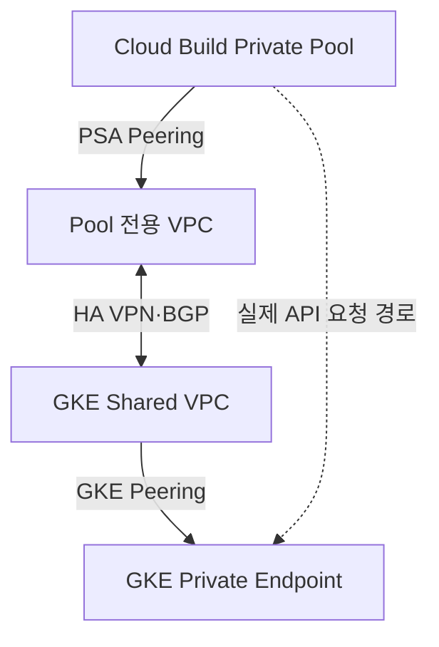

# Private Pool → Private GKE 연결

이 버전의 기본 설정은 `sandbox_setup_01_gcloud/configs/provisioner-env.yaml`의 `GKE_ENDPOINT_MODE=internal`입니다.

Cloud Build와 GKE의 관리 네트워크는 VPC Peering 뒤에 있습니다. Peering은 전이 라우팅을 지원하지 않으므로 같은 Shared VPC 연결만으로 Private Pool에서 GKE Private IP에 도달할 수 없습니다. 1~3단계 명령에는 HA VPN/BGP 자동 구축이 포함되지 않습니다.

## 사설 IP 경로

네트워크 관리자가 Pool 전용 VPC와 PSA, 양쪽 HA VPN·Router·BGP를 구성하고 Pool CIDR과 GKE Control Plane CIDR의 광고/커스텀 경로 전파를 검증해야 합니다. GKE Authorized Networks에는 Pool 소스 CIDR이 포함되어야 합니다.

현재 3단계 문서의 Pool은 기존 Shared VPC에 연결합니다. 이 예제만 실행해 VPN 경로가 만들어졌다고 판단하면 안 됩니다. 전용 VPC 토폴로지를 선택하면 02-network.md/03-foundation.md의 Worker Pool peered-network/PSA 대상과 공통 변수를 네트워크 설계에 맞춰 함께 수정해야 합니다. 기존 Pool의 네트워크를 자동 교체하지 않습니다.

## DNS endpoint 대안

provisioner-env.yaml의 `GKE_ENDPOINT_MODE=dns`를 명시적으로 설정하면 Runner가 `get-credentials --dns-endpoint`를 사용합니다. 이때 GKE DNS endpoint와 token 인증, Google API/DNS 접근 경로가 필요합니다. 기존 Cluster의 DNS endpoint가 비활성 상태이면 DNS 방식으로 진행하지 않습니다. 3단계의 create-auto는 기본 사설 IP 설정이며 기존 Cluster의 DNS 설정을 자동 변경하지 않습니다. 관리자가 해당 설정을 검토·변경한 다음 다시 실행합니다.

두 방식 모두 실제 Pool에서 인증·접속을 확인한 후 과제 Workflow를 실행합니다. 외부 IP가 없는 Worker Pool의 DNS/Google API 연결도 별도 확인해야 합니다. GKE/Cloud Run/Workflow를 삭제하거나 원본 Terraform을 apply해서 연결을 고치지 않습니다.
