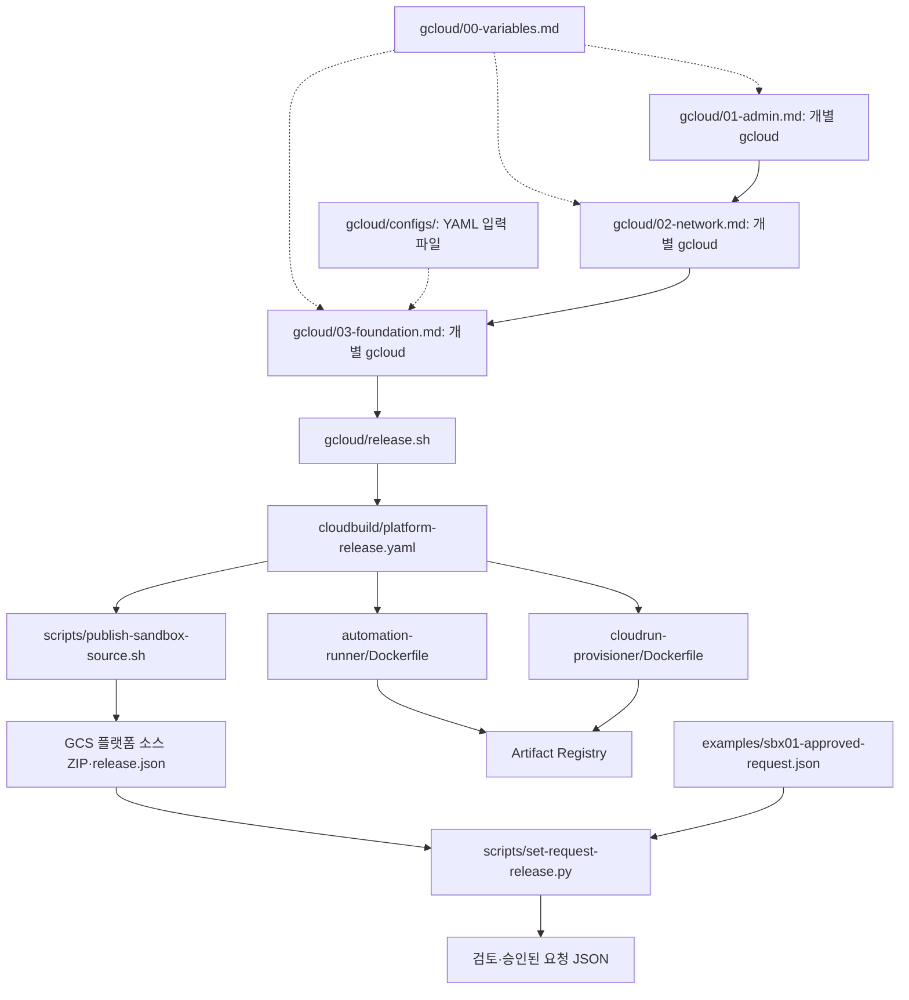
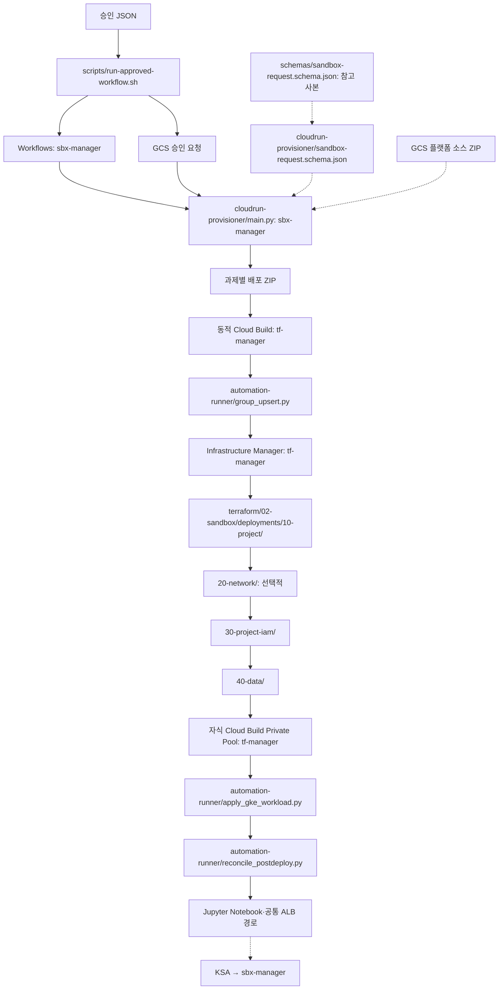
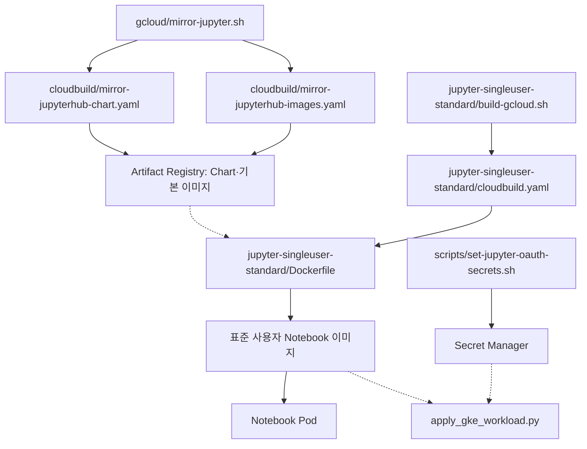
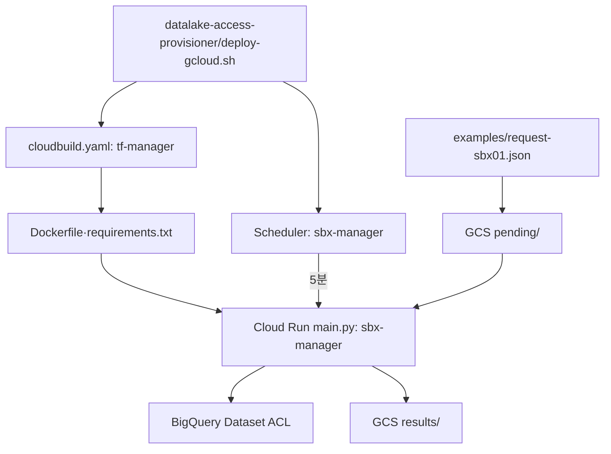

# 폴더와 파일 관계

실선은 실행/호출, 점선은 설정/소스 참조입니다. 1~3단계는 모두 gcloud입니다.

각 Terraform 폴더의 main.tf/variables.tf/versions.tf는 함께 읽습니다. 최초 기반용 Terraform 00-admin/00-network-host/01-foundation과 중복 배포 경로는 제거했습니다. scripts/group_upsert.py는 Runner 안의 동일 파일과 동기화해 유지합니다.
